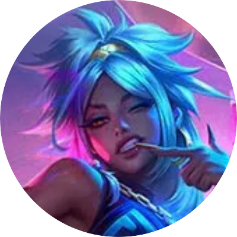

<a href="README.md">
  
</a>
<a href="README-TR.md">
  
</a>

  <br />
  <br />

<div align="center">
  
  <br />
  <br />

  <p>League of Legends’ın Elementler İmparatoriçesi Qiyana’ya adanmış etkileşimli bir hayran sitesi.</p>


  <p>
    <a href="#demo">Demo</a> •
    <a href="#about">Hakkında</a> •
    <a href="#features">Özellikler</a> •
    <a href="#tech">Teknolojiler</a> •
    <a href="#setup">Kurulum</a> •
    <a href="#license">Lisans</a>
  </p>

  <br />
  <br />
</div>

## <a id="demo"></a> 📷 Demo

- [https://qiyana.vercel.app](https://qiyana.vercel.app)

## <a id="about"></a> 📋 Hakkında

**Qiyana Universe**, Qiyana’nın hikâyesini, kostüm çizimlerini ve seçilmiş müzikleri bir araya getiriyor. The Empress bölümünde Ixtal kökenlerini keşfedebilir, Spotlight bölümünde True Damage Know My Name Qiyana’yı inceleyebilir veya galeride tüm çizimlere göz atabilirsiniz.

## <a id="features"></a> ✨ Özellikler

- **Kostüm seçici.** Kostümler arasında geçiş yaparak ana ekrandaki çizimi değiştirin.
- **Çizim galerisi.** 11 çizime göz atın, çizimleri büyütün ve tek tek indirin. Büyütülmüş çizimler arasında ok tuşlarıyla gezinin.
- **Odak modu.** Çizime ve müziğe odaklanmak için menüyü ve giriş metnini gizleyin. Tarayıcınız destekliyorsa tam ekrana geçin.
- **Müzik çalar.** Üç parça arasında geçiş yapın ve ses düzeyini ayarlayın. Müzik çalar ses ayarınızı hatırlar.

## <a id="tech"></a> 🛠️ Teknolojiler

`Next.js` · `React` · `TypeScript` · `CSS` · `Lucide React`

## <a id="setup"></a> 🚀 Kurulum

### Gereksinimler

- **Node.js**

### Adım Adım Kurulum

1. **Depoyu klonlayın**

   ```bash
   git clone https://github.com/xkintaro/qiyana.git
   cd qiyana
   ```

2. **Bağımlılıkları yükleyin**

   ```bash
   npm install
   ```

3. **Geliştirme sunucusunu başlatın**

   ```bash
   npm run dev
   ```

Uygulamayı şu adreste açın: [http://localhost:3000](http://localhost:3000).

## <a id="license"></a> 📄 Lisans

Bu proje MIT Lisansı altında lisanslanmıştır. Detaylar için [LICENSE](LICENSE) dosyasına bakabilirsiniz.

#

<p align="center">
  <sub>❤️ Developed by "Mustafa TAŞAL" (kintaro)</sub>
</p>
