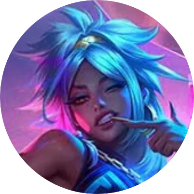

<a href="README.md">
  
</a>
<a href="README-TR.md">
  
</a>

  <br />
  <br />

<div align="center">
  
  <br />
  <br />

  <p>An interactive fan site dedicated to Qiyana, the Empress of the Elements from League of Legends.</p>


  <p>
    <a href="#demo">Demo</a> •
    <a href="#about">About</a> •
    <a href="#features">Features</a> •
    <a href="#tech">Tech</a> •
    <a href="#setup">Setup</a> •
    <a href="#license">License</a>
  </p>

  <br />
  <br />
</div>

## <a id="demo"></a> 📷 Demo

- [https://qiyana.vercel.app](https://qiyana.vercel.app)

## <a id="about"></a> 📋 About

**Qiyana Universe** brings together Qiyana’s story, skin artwork, and a curated soundtrack. Explore her Ixtal origins in The Empress, see True Damage Know My Name Qiyana in the Spotlight, or browse the full artwork collection.

## <a id="features"></a> ✨ Features

- **Skin carousel.** Switch skins to change the artwork on the home screen.
- **Artwork gallery.** Browse 11 illustrations, open them at a larger size, and download individual images. Use the arrow keys to move through the enlarged artwork.
- **Focus mode.** Hide the navigation and hero text to enjoy the artwork and music, with fullscreen where supported.
- **Music player.** Switch between three tracks and adjust the volume. The player remembers your volume setting.

## <a id="tech"></a> 🛠️ Tech

`Next.js` · `React` · `TypeScript` · `CSS` · `Lucide React`

## <a id="setup"></a> 🚀 Setup

### Requirements

- **Node.js**

### Step-by-Step Installation

1. **Clone the repository**

   ```bash
   git clone https://github.com/xkintaro/qiyana.git
   cd qiyana
   ```

2. **Install dependencies**

   ```bash
   npm ci
   ```

3. **Start the development server**

   ```bash
   npm run dev
   ```

Open the app at [http://localhost:3000](http://localhost:3000).

## <a id="license"></a> 📄 License

This project is licensed under the MIT License. See the [LICENSE](LICENSE) file for details.

#

<p align="center">
  <sub>❤️ Developed by "Mustafa TAŞAL" (kintaro)</sub>
</p>
